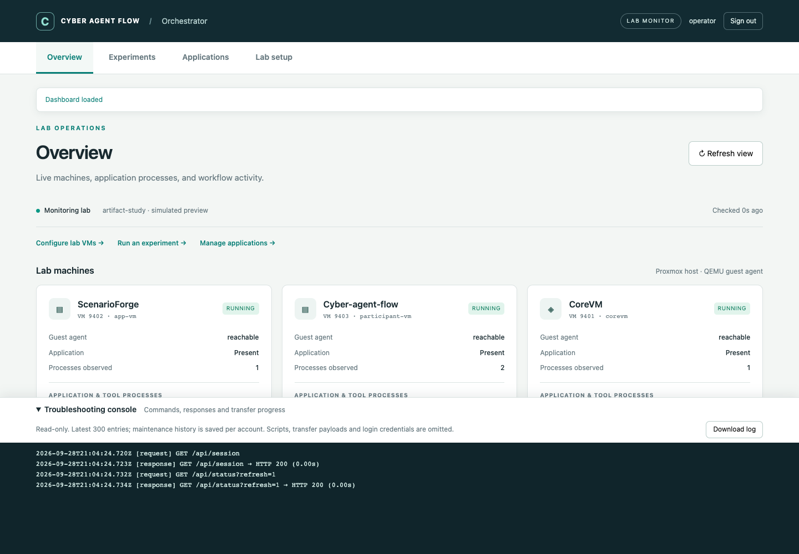
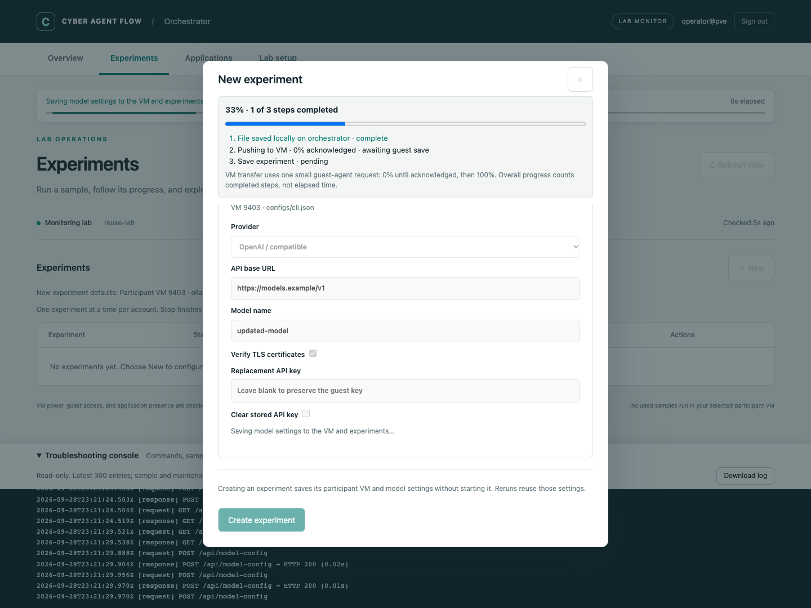
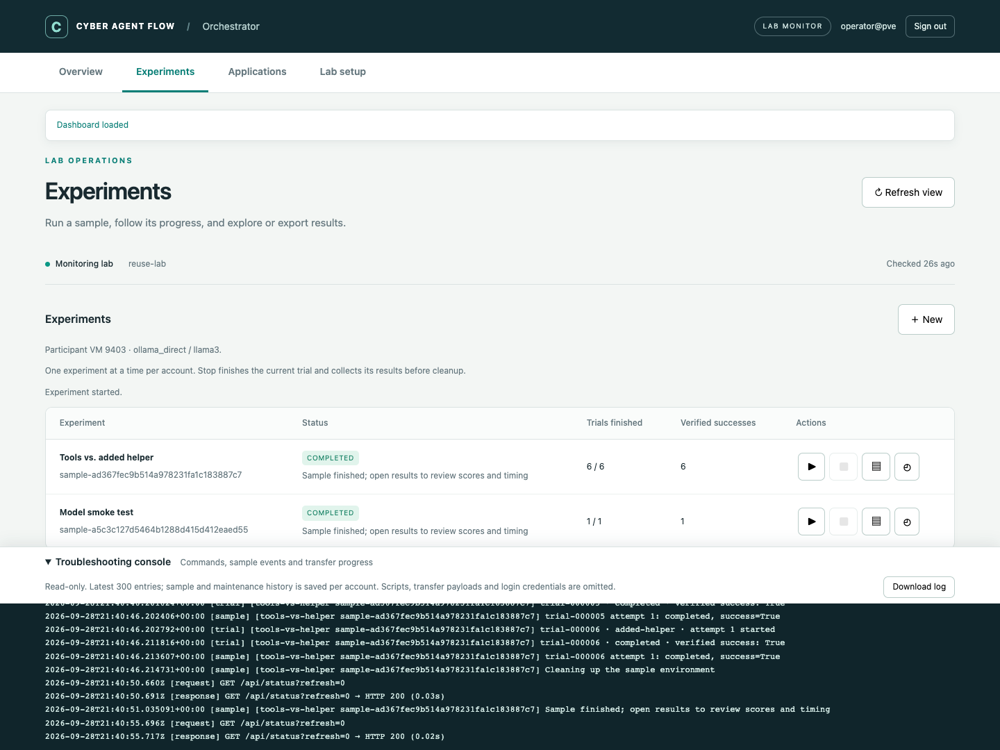
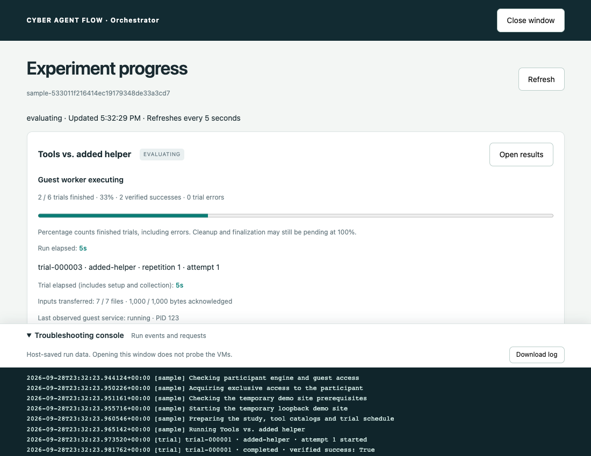
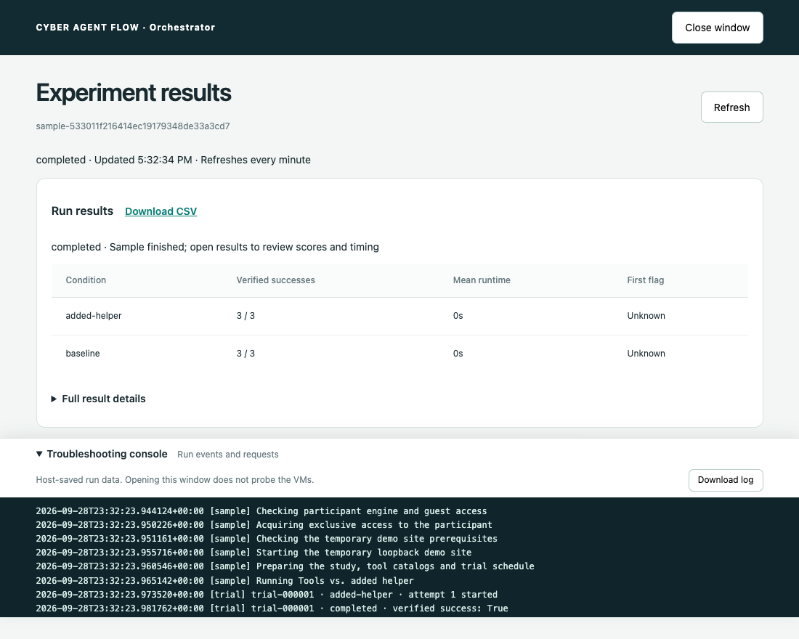

# Live lab dashboard

The WebUI monitors labs and saves per-user VM role selections in PVE mode.
It can launch [two bundled samples](../README.md#run-bundled-samples-in-the-webui)
and download their CSV datasets. Use the CLI for full workflows, resume, recovery
and other exports. The page shows VM availability, application presence,
process commands and elapsed time, unfinished workflow jobs, and saved run status.



The screenshot uses simulated data for browser verification, not a live Proxmox run.

## Pages and navigation

- **Overview** (`/#overview`): VM power, guest-agent access, application processes,
  elapsed time and unfinished workflow commands. Links lead to setup, experiments
  and application maintenance.
- **Experiments** (`/#experiments`): an experiment table with Run, Stop, View results
  and Open progress icons. **New** opens a full-page experiment wizard. Run configuration
  summaries and CSV downloads are available in a separate results window; full JSON is under
  **Full result details**. **Download Markdown summary** and **Download HTML report + charts** provide shareable run reports with task and system prompts, configured and observed tools, trial outcomes, stage/trial timing, scores, hints, flag progress and reported usage. HTML embeds its charts and opens offline; Markdown uses the companion `experiment-charts.svg`. All three files are also included in the run ZIP and CLI result export. Reports use the latest attempt per trial for comparisons and mark unavailable metrics explicitly.
- **Applications** (`/#applications`): version checks, Update with process-stop
  confirmation, rollback and the latest maintenance outcome. Expand **Maintenance
  history** for older jobs, transfer details and diagnostic records.
- **Lab setup** (`/#setup`): saved per-user VM roles and automatic refresh preferences.
  Local-account mode continues to use VM roles from the workflow configuration.

Navigation stays available during loading and maintenance. Switching pages does
not restart checks, submit changes, clear the console, or discard unsaved form
selections. The current page supports bookmarks, reload and browser Back/Forward.
Unsaved edits persist across page navigation, not a full browser reload. Loading
and maintenance status stays visible across pages; mutation controls retain their
existing busy and permission checks. Configure VM roles first, check application
compatibility on Applications, then run samples on Experiments.

## Start it

On the Proxmox host, after `uv sync`:

```bash
uv run cyber-agent-flow-orchestrator
```

This defaults to `serve`, `workflow.yaml`, `web.yaml`, and `runs/` in the current
directory. Missing default configuration files are created once; missing
certificate pairs are generated on first launch in `./certs`. PVE login is the
default, using the host FQDN, Proxmox CA and `caf-orchestration` group.
Use [PVE login](pve-login.md) to enroll accounts, then choose VM roles in the page.
For local accounts instead, follow [HTTPS and login setup](https-login.md).
Explicit overrides remain supported:

```bash
uv run cyber-agent-flow-orchestrator serve examples/02-deploy-evaluate.yaml --runs-root runs --web-config examples/web.local.yaml
```

Open **https://localhost:8443** and sign in. For direct LAN access, use
`examples/web.lan.yaml` with your hostname and certificate. Loopback access through
an SSH tunnel remains available. TLS and authentication are mandatory in both modes;
the previous unauthenticated HTTP `serve --port` interface has been removed.
The backend remains loopback-only and accepts requests only from its paired proxy.

For future local macOS/Linux/Windows operation, a direct loopback WebUI without
PVE, login, or the HTTPS proxy is planned. It is not implemented yet; see the
[local deployment requirements](interfaces.md#planned-local-desktop-deployment).

The selected workflow YAML and its runtime must validate. `--runs-root` is a host
path relative to the current working directory; it need not exist until you start
a run. The workflow YAML supplies a template; PVE users choose their VM roles
in the page, while local-account mode uses the configured VM IDs. Starting the
WebUI does not start experiments or VMs. Stopping it asks sample workers to finish
the current bounded trial and clean up; independent CLI runs are unaffected.
Use a second terminal for ordinary CLI runs. Restart the WebUI after editing its
configuration.

To reuse ScenarioForge VM IDs and model settings, add
`--provision-config /path/to/scenarioforge-lab.conf`. This creates a separate
profile and initializes eligible roles once per user; saved selections are
preserved. See [provision import](provision-config.md).

## Optional timeouts

**Trial limits** provides **No timeout** beside the participant active time and
tool action limits. **LLM judge** provides the same choice for final judge reviews
and intermediate Monitor checks. Selecting it disables the seconds field and
shows a small **!** icon without expanding the form. Hover or focus the icon
to read the infinite-wait warning; unchecking restores the previous finite value.
The review page and saved settings retain the choice for reruns and derived
experiments. Defaults remain finite.

**No timeout can cause an infinite wait if a tool or model request hangs.** Other
enabled limits still apply: an unlimited tool can be stopped by the participant
active time limit, and judge turn/token or Monitor check-count limits remain in
force. To remove all elapsed-time limits, select all four choices. Cancellation
and guest cleanup controls remain available; unlimited guest services have no
runtime backstop and may need manual cleanup if their coordinator is lost.

Configuration files use integer **0** for `execution.wall_seconds`,
`execution.tool_timeout`, `judge.timeout_seconds`, and
`judge.progress_timeout_seconds`. The choice covers streamed judge requests,
Monitor evidence-review waits, and tool elapsed/idle checkpoints. Explicit
command options such as a tool's own network timeout still apply. Update CAF on
the participant for unlimited tool support; input preflight reports older CAF
checkouts before deployment. Infrastructure RPC/transfer health checks remain
bounded and are separate from these operation budgets.

## Loading and progress

The login form locks its fields and buttons while authentication is pending, and
keeps them locked while navigating after success. Duplicate submissions are
ignored. The dashboard verifies its session before requesting VM status.

During initial/manual dashboard retrieval and VM checks, role saves, result loading
and application maintenance, edit/submit/refresh controls are disabled. Scheduled
background refreshes keep controls usable. If you submit an action during an
in-flight background read, it waits for that read before dispatching; duplicate
submissions are blocked. A status banner shows the
current step and elapsed time. VM-check percentages count finished checks for the
currently authorized selected VMs (for example, 1 of 3 is 33%); they are not an
estimate of remaining time or a claim that every VM is healthy. Authentication,
HTTP requests and maintenance operations use an indeterminate indicator and their
current status because their total work is unknown. Maintenance details remain
readable while an operation is active.

Manual **Refresh view** updates the dashboard using short-lived VM observation caches in PVE mode. **Recheck VMs** bypasses those caches for a fresh scan. **Lab setup → Automatic refresh**
offers Never or every 1, 2, 5, or 10 minutes, defaulting to 1 minute. The preference
is saved in this browser and can be changed while a check is running. Never stops
periodic page refreshes; it does not cancel a check or job already started. With
Never selected, active experiments receive quiet, read-only completion checks every
five seconds. Only a terminal outcome updates the dashboard experiment row,
without a loading modal. These checks stop once the experiment finishes and do not
start VM probes. With automatic refresh enabled, active operations report progress
every five seconds.
Automatic reads do not overlap, and polling pauses during a save or other
foreground action. On a request
failure, controls unlock for retry; temporary service errors do not themselves
send the user back to login. A confirmed expired session still requires login.
Experiment jobs continue in the background with their existing run controls.

## Application versions

On **Applications**, use **Check version**, **Update** and **Roll back** for the selected CAF and
ScenarioForge VMs. Updating/rolling back requires the `caf-maintainers` PVE group;
checking versions uses ordinary VM access. Updates run in background workers and
preserve local data. See [application maintenance](application-updates.md) for
setup, dependency limits, service restarts, source repositories and recovery.

## Troubleshooting console

The collapsible console is fixed to the bottom of the viewport on every workspace
page, with its own scroll area. Page content can scroll fully above the dock.
Navigation preserves the same console and scroll position. It shows dashboard API request/status timing
and maintenance activity: host Git commands and their bounded output, guest-agent
operations, `qm` execution/status responses, authorization timing and file-transfer
acknowledgements. It is read-only. Hide/show is saved in this browser, and
**Download log** exports the displayed text. Both remain usable during loading or
maintenance. The view follows new entries when scrolled to the bottom; scroll up
to keep reading older entries.

During a source upload, the maintenance card shows acknowledged bytes, percentage,
average KiB/s and the last acknowledgement time. This percentage describes the
file transfer, not the whole update. Reaching 100% written is followed by a guest
size/SHA-256 check, then application validation and activation. No new acknowledgement
means the current command or authorization check may still be waiting; consult the
timestamped console. Evaluator 0.4.2+ uses 512 KiB stdin upload blocks and synchronous
write acknowledgements to reduce round trips. Downloads still use 16 KiB blocks.
Fresh per-dispatch permission checks and full-file checksum verification remain;
see [upload performance and installation](application-updates.md#upload-performance).

Maintenance traces are private to the signed-in account, persisted as
`RUNS_ROOT/_users/<owner-hash>/updates/<job-id>/console.json`. Each file keeps the
latest 100 events; the dashboard reads traces for the latest three jobs and shows
at most 300 entries together with browser requests. Browser-only request entries
reset on reload. Old jobs started before this update have no trace. Trace events
arrive with active-operation status reads (normally every five seconds).

The console omits login bodies, cookies/headers, guest-helper source, RPC file
contents and base64 payloads. Responses use selected metadata and common credential
patterns are masked in host command output. Redaction is best effort: review an
export before sharing it. This is not a full shell transcript or an agent
prompt/response log; inner guest commands are represented by their guest operation
and its result, and captured host Git output appears when that command finishes.
Session/access errors clear the private console view along with the dashboard.

## Bundled samples

See the [illustrated sample guide](bundled-samples.md) for a figure and detailed
explanation of what each included experiment does and measures.

Choose **New**, select either bundled sample, and move through the wizard with
**Continue** or the left navigation. On **Review & create**, review the settings
and press **Create experiment**.
The builder shows its description, trial budgets, current experiment model and
CAF model settings. The model fields are editable immediately and prefilled from
saved experiment defaults. **Pull from VM** optionally replaces them with the
participant's configuration after confirmation. **Apply settings** saves edits to
the VM and updates the defaults; no explicit Pull is required. A failed Apply shows
an error and can be retried. Apply edits before selecting **Create experiment**.
Creation captures the saved VM and model configuration in a **Ready** row without
starting it or writing settings to the VM again. Its progress shows each creation
step and retains any failure details for retry.

The final review links back to each step and lists any missing requirements.
Creation saves the experiment without starting it.



Each row has four labeled icon buttons:

| Icon | Action |
| --- | --- |
| ▶ | Run a ready experiment, or run a finished experiment again in a new row |
| ■ | Stop after the current bounded trial, collect its output and clean up |
| ▤ | View results already saved on the orchestrator host, including failed runs |
| ◴ | Open the selected run's progress window |



Before scenario preparation, a VM preflight reserves the selected VMs and checks
for leftover CAF services. It stops jobs recorded in inactive runs, including
evaluation workers and preparation hooks, while preserving their files and logs.
An active run or an unrecognized active CAF service blocks startup. The Progress
window shows the readiness and cleanup outcome for each VM.

Only one experiment can run per account at a time. The server enforces this
across browser tabs, and Run buttons stay disabled during execution and cleanup.
Stop changes the status to **Stopping** until the current trial finishes and
cleanup completes. It does not immediately kill a model request or worker.
A stopped run retains its collected results with status **Cancelled**; rerunning
creates a separate run and preserves the original. Trials that never started
have no output to collect.

**Open progress** opens a phase workspace in a separate browser window for the selected run. Starting
or stopping a run provides an Open progress link. Closing the window does not stop
execution. You can keep Results and Progress beside the dashboard, or close the
dashboard and leave either window open. Each window has its own persistent
troubleshooting console. Browser preferences may open a tab instead of a window;
if popups are blocked, the dashboard offers a new-tab link.



The progress workspace keeps **Phase progress** and adds **Visualize**, an
interactive attack graph built from the frozen ScenarioForge challenge plan.
Select a trial or run configuration, zoom, drag to pan, use **Fit graph**, or
**Focus CAF** to center the activity lane (or the latest Monitor challenge
when no activity lane exists). Selecting a node
shows its supported criteria, discovered evidence and citations, checkpoint
turn, dependencies, and hints or solutions actually released. The assistance
timeline shows the same releases across challenges. Unreleased hints, solutions
and private expected answers are excluded from the visualization snapshot.

| Color | Meaning |
| --- | --- |
| Green / solved | Required challenge criteria have supporting verification. |
| Amber / partial | Some criteria or cited discoveries are supported; completion is not verified. |
| Blue / targeted | Execution evidence shows an attempted target; completion is not verified. |
| Grey / other | No supported progress classification is available yet. |

The judge serves as the **Monitor** at intermediate evidence checkpoints, using
the configured judge model, progress-check timeout and check limit. Monitoring
can run with hints disabled; it supplies no guidance in that case. Monitor focus
is the latest observed activity, not a continuously tracked VM location. A
missing or failed check stays unverified and is shown explicitly. Final criterion
results override intermediate completion judgments; final scoring remains an
independent review. Tasks without a dependency plan show independent success
criteria instead of invented connections.

**Visualize** is the first and default progress view; **Phase progress** is the
second tab. Explicit phase links still open Phase progress. Visualize uses an
editor-style workbench. A narrow **Lab preparation** canvas
on the left stacks CAF, ScenarioForge and CORE vertically. The adjacent
**Execution** canvas shows agent activity vertically on its left and challenges
to the right. Both canvases start zoomed out to include their nodes, with
independent zoom and pan. **Fit preparation** and **Fit graph** restore their
overview.

A collapsible **Current step** box at the bottom left follows the
coordinator, showing the step number/total, status, purpose and latest operation
or error. **Open phase details** opens that step in Phase progress. The box stays
on the live coordinator step when a different trial or node is inspected.

Drag the dividers to resize the preparation sidebar and bottom output panel,
or focus a divider and use arrow keys. Double-click a divider to reset its size.
Pane chevrons and the activity rail collapse/reopen preparation, execution and
output. Agent activity, challenges, individual CAF/judge transcript panes,
preparation-check details, status and legend sections also collapse. Pane sizes
and main collapse choices persist in the browser, independently of experiment
configuration. Clicking a node reopens its details panel.

Run state, last-update time and streaming/polling status appear beside **Run
monitor**, above the canvases. The dock has no status footer covering its content.

The bottom panel provides **Selected node**, **Transcripts**, **Hints & solutions**
and **Run log** tabs. The troubleshooting console is available in Phase progress.
Each output scrolls
independently; live updates preserve tab and transcript scroll positions. The
**Now** strip shows action/targets and the tab row identifies the active speaker.
**Challenges** and **Focus CAF** navigate the execution canvas. Smaller screens
keep the canvases adjacent and stack transcript panes in the bottom panel.

**Dock Follow Actions**, at the top right, follows the current trial and switches the
bottom dock to Run log during preparation, Transcripts during CAF/judge work,
and Hints & solutions when new assistance is released. It is off by default;
the browser remembers the toggle. Unchanged status polls leave your chosen tab
alone, and following stops when the run finishes or updates go stale. It does
not move keyboard focus, pan the canvas or change transcript **Follow latest**
scrolling preferences. Turn it off to stay on a chosen tab.

The **Transcripts** dock places **Cyber-Agent-Flow** and
**LLM Judge** side by side. Both show the trial selected above the graph. The
working speaker is highlighted; CAF shows **Paused** during a Monitor/judge
review. Judge startup output is explicitly labelled **Test LLM Judge** and is
separate from trial scoring. Completion and expired status feeds stop the active
markers without clearing the recorded text.

Transcripts show readable message text and labelled tool/judge fields.
Original structured events are included in the run bundle.

Speaker names, activity badges and scroll controls share a compact toolbar.
Hover the toolbar for trial and last-update details. The hint-unlock strip stays
one line high, leaving the rest of the dock for output.

Each pane scrolls independently. **Follow latest** pins new output to the bottom;
scrolling up pauses following for that pane. **Latest** resumes it. These choices
and scroll positions are remembered per selected trial during the window session.
Updates use the shared SSE host-status feed (with polling fallback), including when dashboard
refresh is Never, with no extra guest calls. Transcript updates do not redraw the
graph or replace unchanged log entries. On narrow screens the panes stack.
Provider-emitted reasoning is shown when available; judge output remains visible
only to the experiment owner and can contain private references or solutions.

Released assistance has its own visual state: a **teal unlocked badge** for
hints and a **purple unlocked badge** for solutions. Each challenge shows counts
and the last assisted turn. A new release briefly highlights its node and its
color-coded timeline entry, and the latest-release banner links straight to the
delivered text. Badges remain when you return to a saved run; opening or polling
an existing release does not replay the effect. Reduced-motion preferences use a
static highlight. Task-wide guidance stays task-wide. These indicators use
saved assistance-release events, never unreleased guide content or the judge's
inference that a hint might have been useful. Receiving guidance does not mark
a challenge complete or unlock its prerequisites.

An **Agent activity** lane connects **Cyber-Agent-Flow → tool → recorded
IP/range → matching challenge**. Flowing blue arrows show tool targets, including
unmapped hosts and IPv6; tool actions without an IP use a generic node. Matching
a target to a challenge does not mark that challenge solved. Dotted purple links
show Monitor context separately from network contact. Select a tool/action or
IP node for its recorded source; **View agent transcript** opens that trial's
CAF pane below the graph. During review, **View judge transcript** opens the
adjacent judge pane. The existing pan/zoom and trial selection work
across all lanes.

Thinking bubbles distinguish **Reasoning** (only when the provider emitted a
reasoning event), **Model response** (waiting), and **Responding** (streamed
answer). A model event replaces the previous tool action immediately; IPs in
reasoning text never become scan targets. During a progress review, the lane
shows CAF paused and the **LLM Monitor** working. Arrow motion stops on stale
updates or finished execution and respects reduced-motion preferences. Historical
arrows remain labelled as recorded activity. No extra VM probes or LLM calls are
made to draw this lane.

Live activity adds a blinking blue outline to the current challenge and chips
for literal IPs or CIDR ranges in recorded tool arguments, including IPv6.
Matched targets also pulse inside the graph; targets without a known challenge
remain selectable in the activity bar. These are attempted interactions, not
proof of connectivity or success, so the solved/partial colors stay unchanged.
Reasoning, prompts, guides and tool-output mentions alone do not create live IP
targets. The Monitor can associate a challenge with IPs only when they appear in
its cited execution evidence; its recent focus supplies challenge context when
an action has no recorded IP. No extra judge calls are added for animation.

Completed actions flash briefly (12 seconds); in-flight actions require a fresh
worker heartbeat (45 seconds), and Monitor-only context expires after two
minutes. Blinking pauses during Monitor review or transcript catch-up and stops
when execution finishes, status updates stall, or the activity lease expires.
The working lab component and active challenge card also blink, with a
**WORKING** label on lab components. This follows the current workflow phase
even between tool events; during deployment both ScenarioForge and CORE show
work. The Monitor indicator blinks while reviewing and pauses the participant
component indicator for that review. Completion colors stay unchanged.
Reduced-motion preferences use a static
active outline instead. New runs collect action timestamps automatically with
the updated evaluator worker; no CAF or ScenarioForge VM update is needed for
this display change.

A separate **Lab preparation** canvas sits to the left of execution. **Cyber-Agent-Flow**, **ScenarioForge**, and
**CORE** blocks show recorded guest, runtime/model, scenario-input, deployment
and readiness checks. Green checkmarks mean the listed checks passed; running,
incomplete, pending and failed checks have separate states. Selecting a block
opens its full check list and links to the existing phase details. The currently
running check in the selected-node panel blinks with an **ACTIVE** badge and a blue
background. Passed, failed and pending rows stay still. The blink stops at
completion, after status updates stall, or when the run ends; reduced-motion
preferences keep a static active highlight. **Fit preparation** resets the
sidebar canvas; **Fit graph** resets the execution canvas.

Connection arrows show the task/package handoff **via the orchestrator**, the
ScenarioForge-to-CORE **SSH/gRPC** check, and the **HITL interface** check. The last
is explicitly an interface/configuration check, not an end-to-end target probe.
Preparation is visible before trials or exported tasks exist, and does not
reclassify when a later trial fails. Opening it adds no VM probes.

The tab streams host-saved status changes over Server-Sent Events (SSE) while active,
without extra VM probes or model calls from opening the graph. Selected challenge,
trial and zoom survive updates. Update both the orchestrator and
`cyber-agent-flow-eval` on the host for new observation records; existing runs can
still display saved criterion progress and assistance. ScenarioForge and CAF
continue to work independently.


- Preparation steps: participant checks, exclusive access, demo-site setup, and
  study/catalog preparation.
- Finished trials out of the planned total, verified successes and execution
  errors. The percentage counts terminal trials, including errors, not elapsed
  budget, model tokens, or the probability of success.
- Current trial ID, condition, repetition, attempt, elapsed time and configured
  turn/time limits. Trial elapsed includes preparation and output collection;
  the worker budget applies to execution and is not an end-to-end ETA.
- Guest stage, input files/bytes transferred, last observed service state/PID,
  and when that stage was last recorded, when supported by the host evaluator.
- Per-trial outcomes and scores, recent timestamped events, and a link to results.
- Recorded trial errors appear directly below the trial table and in results.
  Progress streams saved host data; Results refreshes every 5 seconds during active
  execution. After completion, both follow the dashboard refresh preference
  (one minute by default); Refresh reloads immediately. These reads
  do not start VM checks or fetch outputs from the participant. PVE session/access
  checks still apply.

**View results** opens a separate window with condition summaries, trial errors,
CSV download and expandable full JSON. Use **Close window** or the browser window
controls to close it. Reopening the same view for a run reuses its named window.
URLs can also be reloaded or opened directly while signed in:
`/run?view=results&run=<run-id>` and `/run?view=progress&run=<run-id>`.

Finished scenario experiments show **Analyze, generate helper & rerun**. The modal
reports ten checkpoints while the host selects participant evidence, asks CAF to
analyze it on the participant VM, freezes the generated Markdown helper, builds
paired original/helper conditions and queues the derived experiment. A progress
link opens when launch succeeds. The action excludes judge and private-reference
files, preserves the source run, and records parent/evidence/model lineage in the
new run. It uses the participant model credential already stored in the guest.



Failed attempts also show **Failure details** from files already collected on
the host: model-call error messages and expandable **Collected worker log** tails.
This works for existing failed runs after updating the orchestrator; no rerun or
VM connection is required. Model-call previews include only the error, not request
or response bodies. Common credential fields are redacted. Previews cover up to
20 failed attempts, the last 10 call records per output location, and the last
80 log lines (up to 12,000 characters). Missing or unreadable diagnostics are
reported explicitly; opening results does not attempt remote recovery.

A compact status notice follows the active sample across all pages. The dedicated Progress workspace streams changes to saved run data
while execution is active, including when dashboard refresh is Never. It stops
when execution finishes if automatic refresh is off. Run/trial elapsed clocks
advance between reads.
All guest stages come from host transport journals; viewing progress adds no
guest RPCs. Slow guest calls may leave a stage unchanged until they return.
The evaluation phase displays emitted CAF prompts, responses, tool calls/results
and judge output as they are collected; provider reasoning appears only if emitted.
Verification scores appear after outputs are collected. A finished trial can fail
verification without being an execution error.

Trials can reach 100% while demo-site cleanup is pending. The run remains active
until cleanup finishes, and cleanup failures are reported as failures. If the
coordinator disappears, unfinished trials are marked unconfirmed and live clocks
stop. Older evaluator checkouts still show trial counts and timing, with a broader
guest-stage description. Update the host's `cyber-agent-flow-eval` checkout and
restart the orchestrator for detailed preparation/execution/collection stages;
there is no new guest installation or API compatibility requirement.

Sample events are recorded in each owner's run journal and derived from trial
and transport records. The console includes the latest three sample runs along
with maintenance traces and browser requests, bounded to the latest 300 entries.
The main console shows bounded run events. Owner-only transcript panels in
Progress can include prompts, responses and private judge references; common
credential fields are redacted.

Select and save ScenarioForge, participant and CoreVM roles before creating a sample. The fixed XML/bundle and evaluation controls are visible and greyed out. CAF's effective runtime/model configuration is shown separately; model settings can be edited with the existing maintenance permissions.

Creating a sample imports its fixed package. Run prepares deterministic topology and fresh task secrets, deploys on CORE, checks readiness, exports tasks/verifiers, then evaluates CAF. Results and progress retain owner-scoped access. See [demo profile](demo-profile.md) for tasks and [scenario experiments](scenario-experiments.md) for configuration.

### Sample lifecycle and recovery

Runs use the existing workflow coordinator, target reservations and participant locks. All guest calls require current PVE access. One experiment per account and two per server may run. Stop requests take effect at stage/trial boundaries; deployed scenarios remain in place. Interrupted runs retain their journals and artifacts; use authorized workflow recovery before rerunning when necessary. New runs preserve prior results and generate fresh challenge secrets.

Set `samples: [smoke]` or `samples: []` to restrict new samples; existing results remain available. Historical participant-local samples keep their saved configuration and recovery behavior.

## Select machines and application checks

### Application model settings

After saving VM roles on Lab setup, open **Experiments → New**. Its
**Application model settings** section currently contains only Cyber-agent-flow:

- Model fields start with saved experiment defaults and are editable immediately
  for users with application-maintenance access.
- **Pull from VM**, next to the Cyber-agent-flow card title, optionally reads
  connection fields from `<engine.path>/configs/cli.json` through the guest agent.
  It confirms before replacing displayed values.
- **Apply settings** saves provider, base URL, model, TLS verification and optionally
  the API key in the VM, and adopts them for this account and participant VM. It
  preserves unrelated JSON values, including network scope and tools. A missing
  file is created; an existing file gets a private `.caf-model-<id>.bak` backup
  before atomic replacement. Apply reads the guest revision in the background
  when no configuration was pulled, preserving your typed values. A subsequent
  external file change invalidates that revision; Pull again to reconcile it.
- **Create experiment** captures the selected VM and saved runtime, including
  model settings and the guest credential reference. First runs and reruns use
  this snapshot. Reruns require current access to the saved VM; changing Lab setup
  does not move an old experiment. Create a new experiment to use changed settings.
  Standalone evaluator and unscoped CLI runs continue to use explicit YAML.

For an OpenAI-compatible server, select **OpenAI / compatible** (`openai`). The
base URL generally includes `/v1`, and the model name must match the server.
The URL is used inside the participant VM and must be reachable from there.

Pulling shows only whether a file contains an API key. Enter a replacement to
change it, leave the field empty to preserve it, or explicitly select **Clear
stored API key**. Keys travel through `qm --pass-stdin` and are not returned in the
browser response, host preference files, or troubleshooting console. The application
file and backups are mode 0600 with the original owner. When saving CAF settings
with a stored key, the guest creates a separate immutable mode-0600 EnvironmentFile
under `/var/lib/caf-model-config/`; the host stores only its path and variable name.
These snapshots are retained so old runs can continue to reference them.

If CAF uses an environment-only key, its `api_key_env` name is adopted and the
runtime's existing guest `backend.environment_file` remains in use. A key exported
only in an interactive terminal is not inherited by the systemd evaluation worker.
Either configure that guest EnvironmentFile or save a replacement key through this
editor. Clearing the file's key does not clear an independently configured environment.

The full-page New experiment wizard groups setup, agent resources, evaluation,
and final review in its left navigation. Run configurations shows one selection
of tools and guidance at a time, with **Tools** and **Guidance & documents** resource tabs. Categories start expanded;
search and selection filters remain available. **Add run configuration**
copies the current selections for another set of trials. Tool and guidance/document
selections (including separate named run configurations) are saved automatically
in this browser for the signed-in account and workflow. New experiments restore
those defaults, including deliberately empty selections, against the current
participant catalog; unavailable items are omitted. New catalog items stay
unselected when saved defaults exist. Additional free-text guidance, helpers,
and evaluation/model settings are not included in these resource defaults.
Existing experiments keep their frozen inputs.
Each field on **Trial limits** has a **?** popup describing the setting and its
current minimum and maximum. Related hint/time constraints are included in the description.
Helpers presents reusable tool bundles and generated guidance in **Tools** and
**Guidance & documents** tabs, using the same compact checkbox rows and description
popups as Run configurations. Each tab has **Select visible** and **Clear visible**;
these affect only helpers matching the search and preserve hidden selections.
Generated guidance retains its full preview and review controls. Enabled helpers augment every existing condition without adding trials.
Tools extend the frozen catalog; generated guidance is resolved from the owner's
library and copied into saved inputs. Create runs with different helper selections,
then compare them on Studies using Separate runs of the same scenario and a baseline
experiment. The bundled HTTP flag walker supports the demonstration sample.
Switching pages preserves the draft and validation opens the page containing an invalid field.

New experiments enable Judge LLM by default and inherit the participant provider, endpoint and model. These settings remain editable. In **New → Evaluation → Judge LLM**, enter an optional **Judge API key** when choosing a separate model.
The key controls are disabled while participant model settings are inherited;
the stored host judge key for that endpoint is reused. Uncheck the inheritance
option to edit a separate judge key. An entered key is saved when you create the
experiment, in a private host credential directory
outside run outputs. Leave blank to reuse the key saved for your account and
endpoint, or its host environment key. The form displays whether a key is
available. **Clear stored judge key** selects no key for new experiments at that
endpoint. Replacing or clearing does not remove the immutable credential retained
for existing experiment reruns. Raw keys are never returned to the browser,
written in run inputs, copied to guests, or included in results/bundles.

The judge runs on the orchestrator host and uses a separate credential. A blank
participant replacement-key field preserves only the guest key. To persist the
judge's key across normal WebUI launches, set `host_environment_file:
host-secrets.env` in `web.yaml` and store `CAF_JUDGE_API_KEY=your-key` in that
private file (or the variable named by `judge.model.api_key_env`). The path is
relative to `web.yaml`; the file must be owned by the orchestrator account with
mode 0600. Restart after changing it. Shell/service environment values override
file values. This applies to both desktop and Proxmox hosting; the host file is
never included in experiment output or run bundles.

Reading requires access to the selected VM. Saving additionally requires
the configured application maintenance group (default `caf-maintainers`); `updates:
false` disables writes. Mutations refuse while the VM's evaluator lock or guest
maintenance lock is held. No application restart is automatic: open a new CAF
session or restart a long-running app as appropriate. CAF browser-saved settings,
explicit CLI flags and process environment are not imported or overwritten by
this file editor and can take precedence for interactive app sessions.

In PVE mode, **Choose your lab VMs** lists only your available QEMU VMs on the
current node. Save your ScenarioForge, participant and CoreVM selections; they
persist for your account and the dashboard refreshes automatically. Revoked or
unavailable selections are omitted. Access is rechecked on save, before each host
operation, and before returning the current VM view.

The runtime template still specifies guest paths and defaults. In local-account
mode its settings directly select the app and participant VMs:

```yaml
backend:
  type: proxmox
  app_vmid: 9402
  participant_vmid: 9403
  user: participant
engine:
  path: /opt/cyber-agent-flow
  python: /opt/cyber-agent-flow/venv/bin/python
```

Add optional monitoring settings to the **workflow YAML**:

```yaml
monitoring:
  core_vmid: 9401
  scenarioforge_path: /opt/scenarioforge
  scenarioforge_service: scenarioforge-web.service
  core_service: core-daemon.service
  # Set only if you installed CAF as a named systemd service:
  # caf_service: cyber-agent-flow.service
```

CoreVM must be distinct from the app and participant VMs. If omitted, its card
shows “not configured”; the monitor does not guess its VM ID. `core_vmid` is for
observation only. ScenarioForge still uses its own CORE deployment connection;
reset/readiness hooks still select their own VM IDs.

For ScenarioForge, the path defaults to `scenarioforge.repo` for execute workflows
and `/opt/scenarioforge` otherwise. Its default service is the provisioner's
`scenarioforge-web.service`. CAF is checked at `engine.path`; no CAF systemd service
is assumed. Its WebUI does not need to run for evaluator workers to operate.
CORE defaults to `core-daemon.service`.

## What the indicators mean

| Indicator | Evidence / limitation |
| --- | --- |
| VM power | `qm status VMID --verbose 1` on the current Proxmox node; paused emulator state is shown separately |
| Missing | Proxmox explicitly reports a missing VM configuration; command/permission failures remain unknown |
| Guest agent reachable | A bounded Python inspection command succeeded through QEMU Guest Agent |
| Application present | CAF/SF marker file exists at the configured path; CORE executable or configured service is found |
| Application/tool process | Linux process matched the configured application path/module, a monitored service PID, or its descendants |
| Process elapsed time | Guest `/proc` start time and uptime, displayed as elapsed seconds/minutes/hours |
| Workflow command running | The journaled transient systemd unit is currently active and not exited |
| Command unconfirmed | Journal says unfinished, but no live confirmation is available; it is not assumed to be running |
| Recorded run status | Saved workflow journal, shown separately from the coordinator lock and live guest observations |

The guest probe reads files, process metadata and systemd status. It does not scan
the scenario network, call a model, start an application, inspect application
credentials/environment variables, or mutate lab services. Application presence
and process observations do **not** prove HTTP/API health, model availability,
CORE session readiness, or challenge reachability. Run the existing readiness and
backend checks for those purposes.

Process matching also includes shells/tools running from the configured application
checkout. Up to 40 matching processes are returned per VM, and up to 12 service units
are inspected per poll. Extra jobs remain unconfirmed. This is not a full system
process explorer. The selection list is filtered to the current node.

The monitor uses Proxmox's documented [qm status command](https://github.com/proxmox/pve-docs/blob/master/generated/qm.1-synopsis.adoc).
All VM operations still target the current node; multiple Proxmox hosts and other
hypervisors are not implemented here.

## Refresh and timing

The browser's **Automatic refresh** setting controls idle status requests and new
PVE VM-check batches. Intervals start after the preceding check/action completes;
slow calls never pile up. A page load, a saved role change or **Refresh view** also
requests PVE VM checks using short-lived observation caches. The three roles are checked concurrently with bounded
guest timeouts, off the HTTP request path. Every read still revalidates access.
Each user has a separate cached snapshot. `/api/status?refresh=0` reads progress
without scheduling probes; `?refresh=1` requests a batch if none is running.
Guest application/process observations are cached for 60 seconds, or five seconds
when workflow jobs are active; power observations are cached for five seconds.
Cached guest observations retain their original timestamp and are labeled in VM
cards. **Recheck VMs** (`?refresh=1&fresh=1`) bypasses observation caches.
Completed experiment summaries are reused for up to five minutes, invalidated
when workflow/evaluation data changes or a coordinator becomes active. Active
experiment status and access checks remain fresh.
The unqualified status API retains the server cache interval (`--poll-seconds`,
default 10, minimum 2, maximum 300 seconds).

In legacy local-account mode, the shared server monitor still runs on
`--poll-seconds`; the browser setting controls only how often its cache is read.
Check age and stale/unavailable indicators distinguish the last successful
observation from current activity. Never still loads once when the page opens,
and you can use **Refresh view** at any time the dashboard is idle.

Elapsed process clocks advance between observations; exited processes disappear
on the next successful poll. Unconfirmed job timers do not advance in the browser.
New workflow, worker and per-trial-hook journals include command arguments and
start timestamps. When a live service start timestamp is available, the UI uses
the guest's monotonic clock. Host journal timing is explicitly labeled and includes
dispatch/setup time. Older journals may show unavailable commands or timing.

Command arguments can contain private data. Common password/token flags,
Authorization headers and URL credentials are masked for display, but this is
best-effort redaction. Do not treat the dashboard as a sanitized public report.
Private evaluator answers and prompts are not loaded into the dashboard API.

## Validation

```bash
uv run --group dev pytest -q
# Optional browser check; Chrome must be installed:
uv sync --group dev
uv run --group dev python tests/browser_smoke.py /tmp/caf-dashboard-preview
uv run --group dev python tests/browser_navigation.py /tmp/caf-navigation-preview
```

Tests cover VM absence/unknown/paused states, unreachable guest agents, process
matching/elapsed time, secret masking, live versus unconfirmed jobs, configuration
validation, HTTP endpoints, Host/Origin restrictions, cached reads, and the existing
workflow services. Browser checks use simulated data and exercise desktop/mobile
layout, advancing clocks, failure states and inert rendering of command strings.
Navigation checks cover page history and reload, retained form edits and console
content, console visibility during loading, collapse persistence, and content
clearance above the console on desktop and mobile. Navigation adds no API requests.
A live Proxmox end-to-end validation remains outstanding.

## Private experiment results

Use `user-run` / `user-resume` with the same absolute runs root as the WebUI and
authenticate as the experiment owner. See the [README](../README.md#multiple-pve-users)
for commands. Only that account's run directory is listed; click a run for its
results. A caller cannot choose another owner's directory or supply an absolute
path to the API. Results are private to the owner; no project-sharing UI exists.
On an authorization/service error the browser clears displayed private data.
Legacy unowned runs and other users' runs are not shown.

## Dashboard timeouts after selecting VMs

HTTP 504 means the HTTPS proxy timed out waiting for the dashboard backend; it
is not a PVE permission-denied response. Earlier versions used a 15-second total
request deadline and repeated inventory/group checks for each selected VM. A
three-VM save could exceed that deadline on a slower PVE API.

Role saves now share one fresh inventory check while checking each VM's effective
ACL, then recheck account/group access before saving. There is no authorization
cache across requests or guest commands. The proxy allows 60 seconds for a full
request; individual PVE requests retain their four-second socket timeout. Guest
probes run in the background, so slow guest agents do not hold the status response.

Update and restart the orchestrator to apply these changes. If a save times out,
refresh to check whether it completed before saving again. The page clears private
observations when it cannot verify access, and distinguishes a timeout from an
explicit denial. Persistent 504s produce `Dashboard backend timed out` in the
server output with the method/path, without credentials. Check that the PVE API
at `auth.url` is responding promptly; do not broaden ACLs or disable TLS validation
to work around a timeout.

Regression tests cover all three roles over HTTPS with blocked guest probes,
per-VM ACL denial, group revocation during a batch, and the reduced PVE call count.

The optional slow-response browser regression checks locked login/role/refresh
controls, duplicate-submission suppression, measured 0/33/67/100 VM progress,
nonoverlapping requests, transient-error recovery and mobile layout:

```bash
uv run --group dev python tests/browser_loading.py /tmp/caf-loading-preview
uv run --group dev python tests/browser_refresh.py /tmp/caf-refresh-preview
```

The Progress workspace uses the same left navigation and Back/Next layout as the
New experiment wizard. **Overview** summarizes the run and VM roles; each reported
workflow phase has its own page, status, timing and output. The sidebar lists every
phase, including pending, skipped and failed phases. Phases beyond the last
reached phase are greyed out and unavailable in the sidebar, mobile selector,
Back/Next navigation and direct links. They unlock when saved status shows the
run has reached them; completed and failed phases remain reviewable. The phase list comes from the
run rather than assuming a fixed number of steps. On mobile, **Go to phase**
replaces the sidebar links. Phase pages can be bookmarked using `#phase=<id>`.
**Follow active phase** tracks execution automatically; choosing another page turns
following off so live updates preserve the page being inspected. `#phase=active`
keeps following on when the view reloads. The reported phases include: XML verification, preparation, ScenarioForge deployment/readiness/export, package download, readiness validation, reproduction capture, configuration freeze, evaluation-plan import and agent trials. Each stage shows its VM, state, elapsed time, timestamps, attempts, saved log path and any failure. VM cards describe each role. Workflow-stage counts and trial completion are separate; neither is an estimate of time remaining.

Download counters report bytes received by the existing guest-agent transfers and mark verification only after checksum validation. During guest commands, the coordinator records QGA responses and reads up to 8 KiB of new command output every ten seconds. Partial command logs are saved on the host while execution is active; redacted excerpts appear in the troubleshooting console. A thirty-second heartbeat reports elapsed time, collected log bytes and the configured command limit even when output is quiet. Demo preparation reports backend loading, asset copying, CORE settings, topology planning and evaluation-task creation; Python demo/deployment commands run unbuffered. ScenarioForge output exposes its reported CORE operations; live model/tool calls are not streamed. Status and results requests only read host-saved data and never initiate these VM reads. Participant upload counters and service state come from evaluator transport checkpoints. Progress is retained in workflow/results JSON and the run bundle. Older runs without stage timestamps retain their recorded stage states.

In **New → Evaluation**, sample task definitions are visible and locked. Selecting a resolved custom scenario automatically loads its saved task or asks ScenarioForge to build the default from the saved Flow. The Task step keeps the agent prompt visible above **Verification**, **Readiness**, and **Progressive hints** tabs. Verification contains success criteria, challenge steps, and private exact checks; Readiness lists deployment checks; Progressive hints shows challenge-scoped guidance and discovery declarations. Sample tasks use the same tabs. Optional **Scenario details** shows challenge targets, generator information, and imported files when available; it omits repeated task summaries and generic source labels. Tab lists support Left/Right, Home/End, and horizontal scrolling on smaller screens; switching tabs preserves the experiment draft. Experiment-specific task authoring is currently disabled. Opening New automatically loads CAF tools and guidance from the selected participant. **Reload CAF tools and guidance** refreshes the effective CAF native-MCP catalog, generated MCP tool manifests and built-in interactive-session controls. Its searchable selector groups tools and can filter selected, generated, documented, dangerous and interactive tools. The same operation loads CAF tool guides, playbooks, skills, Markdown and RAG documents, reusable templates and structured data into a separate searchable guidance picker. The pulled catalog and selected guidance contents are bound to the selected participant VM and frozen with the experiment. Create remains disabled until the scenario task has loaded and validated. See [scenario experiments](scenario-experiments.md#caf-and-evaluation-configuration).

When an experiment completes with errors, **Progress** and **Results** show an
**Experiment errors** section identifying each unsuccessful trial, condition,
status and recorded error. Missing error messages receive an explicit fallback.
Available collected worker log tails open automatically, and model-call errors
appear beside them. The experiment table shows a trial error count. All of these
reads use saved host artifacts; an agent answer that fails verification while
execution completes is reported through the verified score, not a trial error.

Orchestrated experiments default to `execution.auto_approve_dangerous: true`,
CAF's Python equivalent of `--dangerous-no-prompt`. **Allow dangerous-level CAF
tool actions during unattended trials** makes that setting explicit and editable;
it is independent of selecting `shell_dangerous` in a condition. The flag is saved
in the run configuration and passed to the participant session. Network
allow/disallow rules, tool selection and wall-clock budgets still apply. The participant CAF checkout
must support this option and unattended continuation at tool timeout checkpoints.
Saved interaction events appear in Failure details with the decision type, tool
and timeout checkpoint; arguments and command bodies are omitted from this preview.

The creation loading modal displays server-reported steps and elapsed time. Sample
creation covers eight steps: validation, ScenarioForge connection, bundle transfer,
import, scenario validation, XML snapshot, CAF configuration and experiment storage.
Existing scenario selections use the final four steps. Progress reads are scoped to
the signed-in owner and request ID; they do not initiate guest operations.

The starting-experiment loading modal reports five server checkpoints: saved-run
validation, coordinator capacity, run configuration, VM access and launch-journal
storage, and coordinator submission. It shows elapsed time while the request is
pending. Once the coordinator accepts the run, the Progress view reports the
actual deployment and evaluation stages. Launch status is scoped to the owner and
request ID independently of creation status.

Each phase page has an expandable **Stage details and output** panel. Expansion
choices, transcript trial selection and output scrolling persist as you browse
phases and receive live updates while the window is open. The input-check phase
includes **Test LLM Judge**, a synthetic connectivity, authentication
and JSON-format check. Its deliberately false sample verdict is not an experiment
failure. Check logs explicitly identify the startup test; the evaluation phase includes trial status,
failures, hints and live CAF/judge transcripts. Panels show saved checkpoints, recent output, per-stage guest responses,
command limits/exit codes, checksum-verified transfer counts, saved artifact paths,
readiness checks and trial outcomes. Checkpoint history is retained per stage even
when the main console rolls over. Command previews show at most 60 lines, with
common credentials redacted. These views only read saved host data. Existing runs
can show their saved command logs and artifacts; new checkpoints require a new run.

Active Progress windows use **Server-Sent Events (SSE)** for transcripts, phases,
challenge observations, released hints and completion. One authenticated HTTPS
connection receives an initial snapshot followed by changes. Opening another
window for the same owned run shares its host-side watcher. Local telemetry file
changes are checked/batched every 500ms; unchanged data is not rebuilt until the
five-second state/lock check. No guest operations or model calls are added.

Connections heartbeat while quiet, automatically reconnect with a fresh snapshot,
and fall back to five-second polling if streaming is unavailable or stalled.
Fallback retries streaming automatically; **Refresh** retries immediately.
**Live updates · streaming**, reconnecting and polling labels identify the current
transport. Stream capacity is bounded separately from normal requests. Sessions
are checked before delivery and provider access is revalidated periodically;
logout/revocation closes the feed. Closing a window stops only its subscription.

Results windows retain five-second polling during active execution. Both views
update independently of dashboard Automatic refresh, including **Never**, and
updates do not reopen the loading modal. Completion arrives through the stream;
with Never selected, all automatic run updates stop afterward. Other refresh
intervals continue to apply to finished runs. Dashboard VM observations and the
existing guest-to-host transcript collection cadence are unchanged: SSE can only
send participant output after it reaches the orchestrator. Restart the
orchestrator after installing this update; VM software updates are not needed.

A trial error of **Guest wall-clock budget exceeded** or **Participant active-time
budget exceeded** is controlled by **New experiment → Trial limits → Participant
active time limit (seconds)**, saved as `runtime.execution.wall_seconds`. Its
**No timeout** toggle saves `0`; maximum turns and other enabled timeouts still
apply. The review page shows the chosen limit. Rerunning an existing experiment
reuses its frozen settings; create a new experiment to use a different limit.

When you save or use participant model settings, the orchestrator calls the
provisioner's `/usr/local/sbin/update-llm-destination` utility. It updates the
persistent Netplan route or DHCP route-service destination and reconciles only
its managed endpoint/gateway exclusions, preserving custom agent policy. The
Desktop shortcut uses this same utility. Model settings are not saved if route
validation or application fails; the utility restores its previous files/routes.

If an installed older helper rejects `--cli-config` or `--json`, an authorized
Apply settings operation backs it up beside the original file with a
`.caf-model-<id>.bak` suffix, installs the bundled current ScenarioForge helper,
and retries once. The save response reports that backup. Read/Pull never
updates the helper; Proxmox maintenance authorization and VM/guest locks still
apply. Symlinks, writable shared helpers and files owned by another user are
not replaced automatically. New model settings remain unsaved if the retry
fails. This repair needs an updated orchestrator host and WebUI restart, without
reprovisioning the participant VM. The bundled source is
`guest_llm_route.py`, copied from ScenarioForge's
`scripts/provision/common/update-llm-destination.py`.

The save response shows the destination, interface, gateway, and a bounded TCP
connectivity check from the participant. An unreachable endpoint is saved with
a warning; the check does not validate credentials or model availability. Saved
experiments retain their original model settings. Create a new experiment to
use the new endpoint. Automatic route updates currently require a literal IPv4
address or a hostname resolving to one IPv4 address; multi-address and IPv6-only
endpoints are rejected before changing routes. Guests without the provisioner
helper explicitly report that their routes were unchanged.

If the endpoint hostname cannot resolve after the bootstrap NIC is removed,
the shared utility configures DNS for just that provider domain on the dedicated
LLM NIC, using its on-link configured/DHCP resolver or gateway. This setting is
persistent. DNS and route files are restored if route setup fails.

When ScenarioForge exports a package but blocks it on readiness, the deployment
stage collects `scenario-readiness.json` before stopping. Progress shows the
failed check and its per-target reasons; the report is included in the run bundle.
Infrastructure failures and missing challenge access procedures remain blocking.


### New experiment wizard

Choose **Experiments → New** to open the full-page builder at `#experiments/new`.
The left navigation groups the steps into Setup, Agent resources, Evaluation,
and Review. Later steps stay greyed out until required fields in the earlier
steps are valid, including applying changed participant model settings and
loading the selected scenario task. Hover a locked step or disabled **Continue**
for the reason; the next-step message also explains what to finish. Defaults and
optional settings do not require extra actions. Earlier steps remain editable;
clearing a required field locks later steps again. On smaller screens the step
selector follows the same rules.

The builder keeps its draft while navigating within the application. **Back to
experiments** returns to the list; **Continue draft** resumes it. **New** asks
before replacing an existing draft. Reloading the page clears the draft.
Secrets are kept only in the existing credential controls and are never printed
in the review summary.

**Run configuration** is the UI name for one selection of tools and guidance.
Usually one is enough. Add another to repeat the same tasks with different
resources; repetitions apply to each task and run configuration. Model, budgets,
hints, helpers, and judge settings are shared. Existing result JSON still uses
the schema field `conditions` and trial field `condition_id`.

**Review & create** shows the scenario, participant model and network, exact
task prompts, tools and guidance, helpers, trial limits, hints, run controls,
and judge settings. Edit links return to the relevant step. Missing requirements
are listed with links, and creation remains disabled until they are resolved.
Creating saves the experiment without starting it.


Run configuration selectors start as **Configuration 1**, **Configuration 2**,
and so on. **Add run configuration** sits beside the selectors and copies the
current tools and guidance. Use a selector’s pencil to unlock its name; Enter or
leaving the field saves it, and Escape cancels the edit. Names must be nonempty,
unique, and at most 80 characters. The trash icon removes that configuration.
Display names are saved with the experiment; internal IDs remain stable when
renaming, so trial records and frozen tool files keep their original references.


Run configurations always use the complete tool catalog pulled from the selected
participant VM; there is no catalog-selection setting. Tools and CAF guidance
are compact checkbox lists. Categories start expanded, and search and filters
remain available. Each item’s **?** button opens a short description popup with
relevant metadata without changing its selection. Escape or clicking outside
closes the popup. Helpers use the same compact layout and can be searched
across tool helpers and generated guidance. Generated guidance retains a full
preview and review controls.

On **Experiments**, select individual inactive experiments or use the header
checkbox to select all inactive experiments. **Delete selected** asks for
confirmation, then permanently removes the selected experiments’ private saved
inputs and local outputs (results, logs and bundles). Active runs and experiments
referenced by saved studies are protected; the server checks the complete
selection before deleting anything. Deletion is scoped to the signed-in owner.


Participant connectivity preflight allows up to 1,024 output tokens for its short
synthetic response so reasoning-capable models can reach final text. It still
requires usable text or a tool call within the existing probe time limit;
reasoning-only output does not count as a successful probe. No real tool is
executed during this check.
